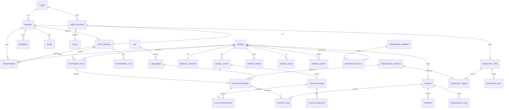

# Dentooth — Data Models & Database Schema

## 1. Entity Relationship Diagram



---

## 2. Complete Entity Definitions

### 2.1 Clinic & Branch

#### CLINIC
| Column | Type | Constraints | Description |
|--------|------|-------------|-------------|
| id | UUID | PK, default gen | Unique clinic identifier |
| name | VARCHAR(255) | NOT NULL | Clinic name |
| logo_url | TEXT | NULLABLE | Clinic logo in storage |
| phone | VARCHAR(20) | NULLABLE | Primary contact |
| email | VARCHAR(255) | NULLABLE | Contact email |
| address | TEXT | NULLABLE | Main address |
| tax_id | VARCHAR(50) | NULLABLE | Tax registration number |
| currency | VARCHAR(3) | NOT NULL, default 'EGP' | Currency code (ISO 4217) |
| locale | VARCHAR(10) | NOT NULL, default 'ar' | Default language |
| tooth_notation | VARCHAR(10) | NOT NULL, default 'FDI' | FDI or Universal |
| created_at | TIMESTAMPTZ | NOT NULL, default now() | Creation timestamp |
| updated_at | TIMESTAMPTZ | NOT NULL, default now() | Last update |

#### BRANCH
| Column | Type | Constraints | Description |
|--------|------|-------------|-------------|
| id | UUID | PK | Branch identifier |
| clinic_id | UUID | FK → CLINIC, NOT NULL | Parent clinic |
| name | VARCHAR(255) | NOT NULL | Branch name (e.g., "Main Branch") |
| address | TEXT | NULLABLE | Branch address |
| phone | VARCHAR(20) | NULLABLE | Branch phone |
| working_hours | JSONB | NULLABLE | `{mon: {start: "09:00", end: "17:00"}, ...}` |
| is_active | BOOLEAN | NOT NULL, default true | Active flag |
| created_at | TIMESTAMPTZ | NOT NULL, default now() | |

#### CHAIR
| Column | Type | Constraints | Description |
|--------|------|-------------|-------------|
| id | UUID | PK | Chair identifier |
| branch_id | UUID | FK → BRANCH, NOT NULL | Branch this chair belongs to |
| name | VARCHAR(50) | NOT NULL | Chair name/number (e.g., "Chair 1") |
| is_active | BOOLEAN | NOT NULL, default true | Available for scheduling |

---

### 2.2 Users & Authentication

#### USER_ACCOUNT
| Column | Type | Constraints | Description |
|--------|------|-------------|-------------|
| id | UUID | PK (= Supabase auth.users.id) | Maps to Supabase Auth |
| clinic_id | UUID | FK → CLINIC, NOT NULL | Clinic membership |
| email | VARCHAR(255) | UNIQUE, NOT NULL | Login email |
| full_name | VARCHAR(255) | NOT NULL | Display name |
| avatar_url | TEXT | NULLABLE | Profile picture |
| role | ENUM | NOT NULL | 'admin', 'doctor', 'receptionist', 'accountant', 'assistant' |
| is_active | BOOLEAN | NOT NULL, default true | Account status |
| created_at | TIMESTAMPTZ | NOT NULL, default now() | |

#### ROLE (Enum values, not a table)
```
admin          — Full access to everything
doctor         — Clinical features, own patients, own schedule
receptionist   — Patients, appointments, basic billing
accountant     — Billing, expenses, insurance, reports
assistant      — Limited clinical features, assigned by doctor
```

#### STAFF_PROFILE
| Column | Type | Constraints | Description |
|--------|------|-------------|-------------|
| id | UUID | PK (= USER_ACCOUNT.id) | 1:1 with user |
| user_id | UUID | FK → USER_ACCOUNT, UNIQUE | Link to auth |
| branch_id | UUID | FK → BRANCH | Primary branch |
| specialization | VARCHAR(100) | NULLABLE | e.g., "Orthodontics", "Endodontics" |
| license_number | VARCHAR(50) | NULLABLE | Professional license |
| phone | VARCHAR(20) | NULLABLE | Personal phone |
| hire_date | DATE | NULLABLE | Employment start |
| salary | DECIMAL(10,2) | NULLABLE | Monthly salary |
| color | VARCHAR(7) | NULLABLE | Calendar color (hex, e.g., "#4A90D9") |

#### ATTENDANCE_LOG
| Column | Type | Constraints | Description |
|--------|------|-------------|-------------|
| id | UUID | PK | |
| staff_id | UUID | FK → STAFF_PROFILE | |
| date | DATE | NOT NULL | Attendance date |
| check_in | TIMESTAMPTZ | NULLABLE | Clock-in time |
| check_out | TIMESTAMPTZ | NULLABLE | Clock-out time |
| status | VARCHAR(20) | NOT NULL | 'present', 'absent', 'late', 'leave', 'holiday' |
| notes | TEXT | NULLABLE | |

---

### 2.3 Patients

#### PATIENT
| Column | Type | Constraints | Description |
|--------|------|-------------|-------------|
| id | UUID | PK | Patient identifier |
| clinic_id | UUID | FK → CLINIC, NOT NULL | Owning clinic |
| patient_number | VARCHAR(20) | UNIQUE within clinic | Auto-generated patient code (e.g., "P-00001") |
| first_name | VARCHAR(100) | NOT NULL | |
| last_name | VARCHAR(100) | NOT NULL | |
| date_of_birth | DATE | NULLABLE | DOB for age calculation |
| gender | VARCHAR(10) | NULLABLE | 'male', 'female', 'other' |
| phone | VARCHAR(20) | NOT NULL | Primary contact (used for SMS) |
| phone_secondary | VARCHAR(20) | NULLABLE | Alternative phone |
| email | VARCHAR(255) | NULLABLE | |
| address | TEXT | NULLABLE | Full address |
| national_id | VARCHAR(20) | NULLABLE | Government ID number |
| photo_url | TEXT | NULLABLE | Patient photo |
| blood_type | VARCHAR(5) | NULLABLE | 'A+', 'A-', 'B+', 'B-', 'O+', 'O-', 'AB+', 'AB-' |
| referred_by | VARCHAR(255) | NULLABLE | Referral source |
| notes | TEXT | NULLABLE | General notes |
| is_active | BOOLEAN | NOT NULL, default true | |
| created_at | TIMESTAMPTZ | NOT NULL, default now() | |
| updated_at | TIMESTAMPTZ | NOT NULL, default now() | |

#### MEDICAL_HISTORY
| Column | Type | Constraints | Description |
|--------|------|-------------|-------------|
| id | UUID | PK | |
| patient_id | UUID | FK → PATIENT, UNIQUE | 1:1 with patient |
| has_diabetes | BOOLEAN | default false | |
| has_hypertension | BOOLEAN | default false | |
| has_heart_disease | BOOLEAN | default false | |
| has_hepatitis | BOOLEAN | default false | |
| has_hiv | BOOLEAN | default false | |
| has_asthma | BOOLEAN | default false | |
| has_epilepsy | BOOLEAN | default false | |
| has_bleeding_disorder | BOOLEAN | default false | |
| is_pregnant | BOOLEAN | default false | |
| is_breastfeeding | BOOLEAN | default false | |
| is_smoker | BOOLEAN | default false | |
| allergies | TEXT | NULLABLE | Free-text allergy list |
| current_medications | TEXT | NULLABLE | Current medications |
| previous_surgeries | TEXT | NULLABLE | Past surgical history |
| other_conditions | TEXT | NULLABLE | Additional notes |
| last_updated | TIMESTAMPTZ | NOT NULL, default now() | When patient last filled this |
| updated_by | UUID | FK → USER_ACCOUNT, NULLABLE | Staff who updated, or NULL if patient self-filled |

#### PATIENT_GROUP
| Column | Type | Constraints | Description |
|--------|------|-------------|-------------|
| id | UUID | PK | |
| clinic_id | UUID | FK → CLINIC | |
| name | VARCHAR(100) | NOT NULL | Group name (e.g., "VIP", "Orthodontics", "Insurance-X") |
| color | VARCHAR(7) | NULLABLE | Tag color |
| description | TEXT | NULLABLE | |

#### PATIENT_GROUP_MEMBER (Join table)
| Column | Type | Constraints | Description |
|--------|------|-------------|-------------|
| patient_id | UUID | FK → PATIENT | |
| group_id | UUID | FK → PATIENT_GROUP | |
| PK | (patient_id, group_id) | Composite PK | |

#### PATIENT_NOTE
| Column | Type | Constraints | Description |
|--------|------|-------------|-------------|
| id | UUID | PK | |
| patient_id | UUID | FK → PATIENT | |
| author_id | UUID | FK → USER_ACCOUNT | |
| content | TEXT | NOT NULL | Note text |
| created_at | TIMESTAMPTZ | NOT NULL, default now() | |

---

### 2.4 Dental Chart

#### DENTAL_CHART
| Column | Type | Constraints | Description |
|--------|------|-------------|-------------|
| id | UUID | PK | |
| patient_id | UUID | FK → PATIENT, UNIQUE | One chart per patient |
| notation | VARCHAR(10) | NOT NULL, default 'FDI' | 'FDI' or 'Universal' |
| chart_type | VARCHAR(10) | NOT NULL, default 'adult' | 'adult' (32 teeth) or 'pediatric' (20 teeth) |
| created_at | TIMESTAMPTZ | NOT NULL, default now() | |

#### TOOTH_RECORD
| Column | Type | Constraints | Description |
|--------|------|-------------|-------------|
| id | UUID | PK | |
| chart_id | UUID | FK → DENTAL_CHART | |
| tooth_number | INT | NOT NULL | FDI: 11-48 / Universal: 1-32 |
| status | VARCHAR(30) | NOT NULL, default 'healthy' | Current overall status |
| is_primary | BOOLEAN | default false | Deciduous (baby) tooth? |
| notes | TEXT | NULLABLE | Per-tooth notes |
| updated_at | TIMESTAMPTZ | NOT NULL, default now() | |
| UNIQUE | (chart_id, tooth_number) | | One record per tooth per chart |

**Tooth Status Enum Values:**
```
healthy, caries, filled, crown, bridge_abutment, bridge_pontic,
root_canal, post_and_core, implant, implant_crown,
missing, extracted, impacted, partially_erupted, 
veneer, inlay, onlay, sealant, temporary,
fracture, attrition, abrasion, erosion
```

#### TOOTH_CONDITION
| Column | Type | Constraints | Description |
|--------|------|-------------|-------------|
| id | UUID | PK | |
| tooth_id | UUID | FK → TOOTH_RECORD | |
| condition_type | VARCHAR(50) | NOT NULL | Condition category |
| surfaces | VARCHAR(10)[] | NULLABLE | Array of: 'M', 'D', 'B', 'L', 'O', 'I' |
| severity | VARCHAR(20) | NULLABLE | 'mild', 'moderate', 'severe' |
| notes | TEXT | NULLABLE | |
| diagnosed_by | UUID | FK → USER_ACCOUNT | Doctor who diagnosed |
| diagnosed_at | TIMESTAMPTZ | NOT NULL, default now() | |
| resolved_at | TIMESTAMPTZ | NULLABLE | When condition was treated |
| resolved_by_procedure | UUID | FK → TOOTH_PROCEDURE, NULLABLE | Treatment that resolved this |

**Surface Codes:**
```
M = Mesial       (toward midline)
D = Distal       (away from midline)
B = Buccal       (cheek side) / F = Facial (front teeth)
L = Lingual      (tongue side) / P = Palatal (upper teeth)
O = Occlusal     (chewing surface — posterior teeth)
I = Incisal      (cutting edge — anterior teeth)
```

#### TOOTH_PROCEDURE
| Column | Type | Constraints | Description |
|--------|------|-------------|-------------|
| id | UUID | PK | |
| tooth_id | UUID | FK → TOOTH_RECORD | |
| plan_procedure_id | UUID | FK → PLAN_PROCEDURE, NULLABLE | Link to treatment plan |
| procedure_type | VARCHAR(100) | NOT NULL | Procedure name |
| surfaces | VARCHAR(10)[] | NULLABLE | Surfaces involved |
| status | VARCHAR(20) | NOT NULL, default 'planned' | 'planned', 'in_progress', 'completed', 'cancelled' |
| notes | TEXT | NULLABLE | |
| performed_by | UUID | FK → USER_ACCOUNT, NULLABLE | |
| performed_at | TIMESTAMPTZ | NULLABLE | Completion date |
| created_at | TIMESTAMPTZ | NOT NULL, default now() | |

---

### 2.5 Treatment Plans

#### TREATMENT_PLAN
| Column | Type | Constraints | Description |
|--------|------|-------------|-------------|
| id | UUID | PK | |
| patient_id | UUID | FK → PATIENT | |
| doctor_id | UUID | FK → STAFF_PROFILE | Treating doctor |
| branch_id | UUID | FK → BRANCH | Where treatment happens |
| title | VARCHAR(255) | NOT NULL | Plan name (e.g., "Full Mouth Rehabilitation") |
| description | TEXT | NULLABLE | Plan notes |
| status | VARCHAR(20) | NOT NULL, default 'planned' | 'planned', 'active', 'completed', 'cancelled' |
| total_cost | DECIMAL(10,2) | NOT NULL, default 0 | Sum of procedure costs |
| discount_amount | DECIMAL(10,2) | default 0 | Discount on total |
| created_at | TIMESTAMPTZ | NOT NULL, default now() | |
| updated_at | TIMESTAMPTZ | NOT NULL, default now() | |

#### PLAN_PROCEDURE
| Column | Type | Constraints | Description |
|--------|------|-------------|-------------|
| id | UUID | PK | |
| plan_id | UUID | FK → TREATMENT_PLAN | |
| catalog_id | UUID | FK → PROCEDURE_CATALOG, NULLABLE | Reference procedure |
| tooth_number | INT | NULLABLE | Tooth involved (NULL for general procedures) |
| name | VARCHAR(255) | NOT NULL | Procedure name |
| description | TEXT | NULLABLE | |
| cost | DECIMAL(10,2) | NOT NULL | Procedure cost |
| quantity | INT | NOT NULL, default 1 | |
| status | VARCHAR(20) | NOT NULL, default 'planned' | 'planned', 'in_progress', 'completed', 'cancelled' |
| sort_order | INT | NOT NULL, default 0 | Sequence in plan |
| completed_at | TIMESTAMPTZ | NULLABLE | When marked complete |
| completed_by | UUID | FK → USER_ACCOUNT, NULLABLE | |
| notes | TEXT | NULLABLE | |
| created_at | TIMESTAMPTZ | NOT NULL, default now() | |

#### PROCEDURE_CATALOG
| Column | Type | Constraints | Description |
|--------|------|-------------|-------------|
| id | UUID | PK | |
| clinic_id | UUID | FK → CLINIC | |
| code | VARCHAR(20) | NULLABLE | CDT code or custom code |
| name | VARCHAR(255) | NOT NULL | Procedure name |
| name_ar | VARCHAR(255) | NULLABLE | Arabic name |
| category | VARCHAR(100) | NOT NULL | 'Preventive', 'Restorative', 'Endodontic', 'Prosthodontic', 'Surgical', 'Orthodontic', 'Periodontic', 'Diagnostic', 'Other' |
| default_cost | DECIMAL(10,2) | NOT NULL | Default price |
| duration_minutes | INT | NULLABLE | Estimated chair time |
| description | TEXT | NULLABLE | |
| is_active | BOOLEAN | NOT NULL, default true | |
| created_at | TIMESTAMPTZ | NOT NULL, default now() | |

---

### 2.6 Appointments

#### APPOINTMENT
| Column | Type | Constraints | Description |
|--------|------|-------------|-------------|
| id | UUID | PK | |
| clinic_id | UUID | FK → CLINIC | |
| branch_id | UUID | FK → BRANCH | |
| patient_id | UUID | FK → PATIENT | |
| doctor_id | UUID | FK → STAFF_PROFILE | |
| chair_id | UUID | FK → CHAIR, NULLABLE | Dental chair assigned |
| plan_procedure_id | UUID | FK → PLAN_PROCEDURE, NULLABLE | Linked treatment procedure |
| title | VARCHAR(255) | NULLABLE | Appointment title/reason |
| start_time | TIMESTAMPTZ | NOT NULL | Start datetime |
| end_time | TIMESTAMPTZ | NOT NULL | End datetime |
| status | VARCHAR(20) | NOT NULL, default 'scheduled' | Appointment state |
| type | VARCHAR(30) | NOT NULL, default 'treatment' | 'consultation', 'treatment', 'follow_up', 'emergency', 'check_up' |
| notes | TEXT | NULLABLE | |
| reminder_sent | BOOLEAN | default false | SMS/WhatsApp reminder sent? |
| color | VARCHAR(7) | NULLABLE | Custom color override |
| created_at | TIMESTAMPTZ | NOT NULL, default now() | |
| updated_at | TIMESTAMPTZ | NOT NULL, default now() | |

**Appointment Status Flow:**
```
scheduled → confirmed → checked_in → in_progress → completed
                                                  → cancelled
                                   → no_show
            → cancelled
→ rescheduled (creates new appointment)
```

---

### 2.7 Billing & Finance

#### INVOICE
| Column | Type | Constraints | Description |
|--------|------|-------------|-------------|
| id | UUID | PK | |
| clinic_id | UUID | FK → CLINIC | |
| branch_id | UUID | FK → BRANCH | |
| patient_id | UUID | FK → PATIENT | |
| invoice_number | VARCHAR(30) | UNIQUE within clinic | Auto: "INV-2024-00001" |
| plan_id | UUID | FK → TREATMENT_PLAN, NULLABLE | Source treatment plan |
| subtotal | DECIMAL(10,2) | NOT NULL | Before discount/tax |
| discount_percent | DECIMAL(5,2) | default 0 | |
| discount_amount | DECIMAL(10,2) | default 0 | |
| tax_percent | DECIMAL(5,2) | default 0 | |
| tax_amount | DECIMAL(10,2) | default 0 | |
| total | DECIMAL(10,2) | NOT NULL | Final amount due |
| amount_paid | DECIMAL(10,2) | default 0 | Total received |
| balance | DECIMAL(10,2) | GENERATED | total - amount_paid |
| status | VARCHAR(20) | NOT NULL, default 'draft' | 'draft', 'sent', 'partial', 'paid', 'overdue', 'cancelled', 'refunded' |
| due_date | DATE | NULLABLE | Payment deadline |
| notes | TEXT | NULLABLE | |
| pdf_url | TEXT | NULLABLE | Generated PDF in storage |
| issued_at | TIMESTAMPTZ | NOT NULL, default now() | |
| created_at | TIMESTAMPTZ | NOT NULL, default now() | |

#### INVOICE_ITEM
| Column | Type | Constraints | Description |
|--------|------|-------------|-------------|
| id | UUID | PK | |
| invoice_id | UUID | FK → INVOICE | |
| plan_procedure_id | UUID | FK → PLAN_PROCEDURE, NULLABLE | Source procedure |
| description | VARCHAR(255) | NOT NULL | Line item description |
| quantity | INT | NOT NULL, default 1 | |
| unit_price | DECIMAL(10,2) | NOT NULL | Price per unit |
| total | DECIMAL(10,2) | NOT NULL | quantity × unit_price |
| tooth_number | INT | NULLABLE | Associated tooth |
| sort_order | INT | default 0 | |

#### PAYMENT
| Column | Type | Constraints | Description |
|--------|------|-------------|-------------|
| id | UUID | PK | |
| invoice_id | UUID | FK → INVOICE | |
| amount | DECIMAL(10,2) | NOT NULL | Payment amount |
| method | VARCHAR(30) | NOT NULL | 'cash', 'card', 'bank_transfer', 'insurance', 'online', 'other' |
| reference_number | VARCHAR(100) | NULLABLE | Transaction reference |
| notes | TEXT | NULLABLE | |
| received_by | UUID | FK → USER_ACCOUNT | Staff who received |
| paid_at | TIMESTAMPTZ | NOT NULL, default now() | Payment date |
| created_at | TIMESTAMPTZ | NOT NULL, default now() | |

#### EXPENSE
| Column | Type | Constraints | Description |
|--------|------|-------------|-------------|
| id | UUID | PK | |
| clinic_id | UUID | FK → CLINIC | |
| branch_id | UUID | FK → BRANCH | |
| category | VARCHAR(50) | NOT NULL | 'materials', 'rent', 'utilities', 'salary', 'equipment', 'maintenance', 'marketing', 'other' |
| description | VARCHAR(255) | NOT NULL | |
| amount | DECIMAL(10,2) | NOT NULL | |
| date | DATE | NOT NULL | Expense date |
| receipt_url | TEXT | NULLABLE | Receipt image |
| recorded_by | UUID | FK → USER_ACCOUNT | |
| notes | TEXT | NULLABLE | |
| created_at | TIMESTAMPTZ | NOT NULL, default now() | |

---

### 2.8 Insurance

#### INSURANCE_COMPANY
| Column | Type | Constraints | Description |
|--------|------|-------------|-------------|
| id | UUID | PK | |
| clinic_id | UUID | FK → CLINIC | |
| name | VARCHAR(255) | NOT NULL | Company name |
| phone | VARCHAR(20) | NULLABLE | |
| email | VARCHAR(255) | NULLABLE | |
| address | TEXT | NULLABLE | |
| contact_person | VARCHAR(255) | NULLABLE | |
| notes | TEXT | NULLABLE | |
| is_active | BOOLEAN | default true | |
| created_at | TIMESTAMPTZ | NOT NULL, default now() | |

#### INSURANCE_POLICY
| Column | Type | Constraints | Description |
|--------|------|-------------|-------------|
| id | UUID | PK | |
| patient_id | UUID | FK → PATIENT | |
| company_id | UUID | FK → INSURANCE_COMPANY | |
| policy_number | VARCHAR(100) | NOT NULL | Insurance policy # |
| plan_name | VARCHAR(255) | NULLABLE | Insurance plan name |
| coverage_percent | DECIMAL(5,2) | default 0 | % covered by insurance |
| max_annual_coverage | DECIMAL(10,2) | NULLABLE | Annual cap |
| used_coverage | DECIMAL(10,2) | default 0 | Amount used this year |
| start_date | DATE | NULLABLE | Policy start |
| end_date | DATE | NULLABLE | Policy expiry |
| is_active | BOOLEAN | default true | |
| created_at | TIMESTAMPTZ | NOT NULL, default now() | |

#### INSURANCE_CLAIM
| Column | Type | Constraints | Description |
|--------|------|-------------|-------------|
| id | UUID | PK | |
| invoice_id | UUID | FK → INVOICE | |
| policy_id | UUID | FK → INSURANCE_POLICY | |
| amount_claimed | DECIMAL(10,2) | NOT NULL | |
| amount_approved | DECIMAL(10,2) | NULLABLE | |
| status | VARCHAR(20) | NOT NULL, default 'pending' | 'pending', 'submitted', 'approved', 'rejected', 'paid' |
| submitted_at | TIMESTAMPTZ | NULLABLE | |
| responded_at | TIMESTAMPTZ | NULLABLE | |
| notes | TEXT | NULLABLE | |
| created_at | TIMESTAMPTZ | NOT NULL, default now() | |

---

### 2.9 Inventory

#### INVENTORY_ITEM
| Column | Type | Constraints | Description |
|--------|------|-------------|-------------|
| id | UUID | PK | |
| clinic_id | UUID | FK → CLINIC | |
| branch_id | UUID | FK → BRANCH | |
| name | VARCHAR(255) | NOT NULL | Item name |
| category | VARCHAR(100) | NOT NULL | 'consumable', 'instrument', 'equipment', 'medication', 'other' |
| sku | VARCHAR(50) | NULLABLE | Stock keeping unit |
| quantity | DECIMAL(10,2) | NOT NULL, default 0 | Current stock |
| unit | VARCHAR(30) | NOT NULL | 'piece', 'box', 'pack', 'ml', 'g', 'tube', 'roll' |
| reorder_level | DECIMAL(10,2) | NULLABLE | Alert threshold |
| unit_cost | DECIMAL(10,2) | NULLABLE | Cost per unit |
| supplier | VARCHAR(255) | NULLABLE | Supplier name |
| expiry_date | DATE | NULLABLE | |
| notes | TEXT | NULLABLE | |
| created_at | TIMESTAMPTZ | NOT NULL, default now() | |
| updated_at | TIMESTAMPTZ | NOT NULL, default now() | |

#### INVENTORY_USAGE
| Column | Type | Constraints | Description |
|--------|------|-------------|-------------|
| id | UUID | PK | |
| item_id | UUID | FK → INVENTORY_ITEM | |
| procedure_id | UUID | FK → PLAN_PROCEDURE, NULLABLE | Procedure that used it |
| quantity_used | DECIMAL(10,2) | NOT NULL | Amount consumed |
| used_by | UUID | FK → USER_ACCOUNT | |
| used_at | TIMESTAMPTZ | NOT NULL, default now() | |
| notes | TEXT | NULLABLE | |

#### INVENTORY_LOG
| Column | Type | Constraints | Description |
|--------|------|-------------|-------------|
| id | UUID | PK | |
| item_id | UUID | FK → INVENTORY_ITEM | |
| change_type | VARCHAR(20) | NOT NULL | 'restock', 'usage', 'adjustment', 'expired', 'transfer' |
| quantity_change | DECIMAL(10,2) | NOT NULL | +/- amount |
| quantity_after | DECIMAL(10,2) | NOT NULL | Stock after change |
| recorded_by | UUID | FK → USER_ACCOUNT | |
| notes | TEXT | NULLABLE | |
| created_at | TIMESTAMPTZ | NOT NULL, default now() | |

---

### 2.10 Lab

#### LAB
| Column | Type | Constraints | Description |
|--------|------|-------------|-------------|
| id | UUID | PK | |
| clinic_id | UUID | FK → CLINIC | |
| name | VARCHAR(255) | NOT NULL | Lab name |
| phone | VARCHAR(20) | NULLABLE | |
| email | VARCHAR(255) | NULLABLE | |
| address | TEXT | NULLABLE | |
| contact_person | VARCHAR(255) | NULLABLE | |
| is_active | BOOLEAN | default true | |

#### LAB_ORDER
| Column | Type | Constraints | Description |
|--------|------|-------------|-------------|
| id | UUID | PK | |
| lab_id | UUID | FK → LAB | |
| patient_id | UUID | FK → PATIENT | |
| procedure_id | UUID | FK → PLAN_PROCEDURE | |
| doctor_id | UUID | FK → STAFF_PROFILE | |
| description | TEXT | NOT NULL | Work description |
| shade | VARCHAR(20) | NULLABLE | Tooth shade (e.g., A2, B1) |
| material | VARCHAR(100) | NULLABLE | Material type |
| cost | DECIMAL(10,2) | NULLABLE | Lab fee |
| status | VARCHAR(20) | NOT NULL, default 'pending' | 'pending', 'sent', 'in_progress', 'ready', 'delivered', 'cancelled' |
| sent_at | TIMESTAMPTZ | NULLABLE | |
| expected_at | DATE | NULLABLE | Expected delivery |
| delivered_at | TIMESTAMPTZ | NULLABLE | |
| notes | TEXT | NULLABLE | |
| created_at | TIMESTAMPTZ | NOT NULL, default now() | |

---

### 2.11 Imaging

#### PATIENT_IMAGE
| Column | Type | Constraints | Description |
|--------|------|-------------|-------------|
| id | UUID | PK | |
| patient_id | UUID | FK → PATIENT | |
| tooth_id | UUID | FK → TOOTH_RECORD, NULLABLE | Associated tooth |
| appointment_id | UUID | FK → APPOINTMENT, NULLABLE | Taken during appointment |
| image_type | VARCHAR(30) | NOT NULL | 'xray_periapical', 'xray_panoramic', 'xray_bitewing', 'xray_cephalometric', 'cbct', 'intraoral_photo', 'extraoral_photo', 'other' |
| image_url | TEXT | NOT NULL | Storage URL |
| thumbnail_url | TEXT | NULLABLE | Compressed thumbnail |
| title | VARCHAR(255) | NULLABLE | Description |
| notes | TEXT | NULLABLE | |
| taken_by | UUID | FK → USER_ACCOUNT, NULLABLE | |
| taken_at | TIMESTAMPTZ | NOT NULL, default now() | |
| created_at | TIMESTAMPTZ | NOT NULL, default now() | |

---

### 2.12 Automation

#### NOTIFICATION_LOG
| Column | Type | Constraints | Description |
|--------|------|-------------|-------------|
| id | UUID | PK | |
| clinic_id | UUID | FK → CLINIC | |
| patient_id | UUID | FK → PATIENT, NULLABLE | |
| type | VARCHAR(30) | NOT NULL | 'sms_reminder', 'whatsapp_reminder', 'birthday', 'lab_notification', 'custom' |
| channel | VARCHAR(20) | NOT NULL | 'sms', 'whatsapp', 'email', 'push' |
| recipient | VARCHAR(255) | NOT NULL | Phone/email |
| message | TEXT | NOT NULL | Message content |
| status | VARCHAR(20) | NOT NULL, default 'pending' | 'pending', 'sent', 'delivered', 'failed' |
| sent_at | TIMESTAMPTZ | NULLABLE | |
| error_message | TEXT | NULLABLE | Failure reason |
| created_at | TIMESTAMPTZ | NOT NULL, default now() | |

---

## 3. Indexes

```sql
-- Performance-critical indexes
CREATE INDEX idx_patient_clinic ON patient(clinic_id);
CREATE INDEX idx_patient_phone ON patient(phone);
CREATE INDEX idx_patient_name ON patient(clinic_id, last_name, first_name);
CREATE INDEX idx_appointment_date ON appointment(branch_id, start_time);
CREATE INDEX idx_appointment_doctor ON appointment(doctor_id, start_time);
CREATE INDEX idx_appointment_patient ON appointment(patient_id, start_time);
CREATE INDEX idx_invoice_patient ON invoice(patient_id);
CREATE INDEX idx_invoice_status ON invoice(clinic_id, status);
CREATE INDEX idx_tooth_record_chart ON tooth_record(chart_id);
CREATE INDEX idx_plan_procedure_plan ON plan_procedure(plan_id);
CREATE INDEX idx_inventory_branch ON inventory_item(branch_id, category);
CREATE INDEX idx_expense_date ON expense(branch_id, date);
```

---

## 4. SQLDelight Schema File Reference

All `.sq` files should be placed at:
```
shared/src/commonMain/sqldelight/com/example/dentooth/
├── Patient.sq
├── MedicalHistory.sq
├── DentalChart.sq
├── ToothRecord.sq
├── TreatmentPlan.sq
├── PlanProcedure.sq
├── ProcedureCatalog.sq
├── Appointment.sq
├── Invoice.sq
├── InvoiceItem.sq
├── Payment.sq
├── Expense.sq
├── InsuranceCompany.sq
├── InsurancePolicy.sq
├── InsuranceClaim.sq
├── InventoryItem.sq
├── Staff.sq
├── Branch.sq
├── Lab.sq
├── LabOrder.sq
├── PatientImage.sq
├── NotificationLog.sq
```
