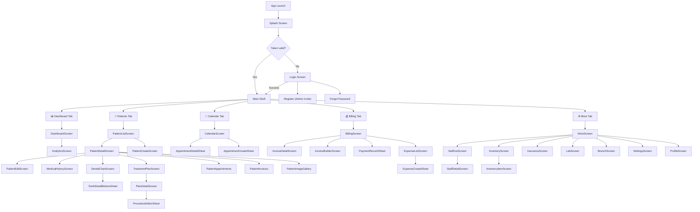

# Dentooth — UI Design System & Navigation

## 1. Design Tokens

### 1.1 Color Palette

#### Brand Colors
| Token | Light | Dark | Usage |
|-------|-------|------|-------|
| `primary` | `#1B6B93` | `#4FC3F7` | Primary actions, top bar, FAB |
| `onPrimary` | `#FFFFFF` | `#003547` | Text/icons on primary |
| `primaryContainer` | `#C2E8FF` | `#004D6B` | Chips, light backgrounds |
| `secondary` | `#4CAF50` | `#81C784` | Success, confirmed states |
| `tertiary` | `#FF7043` | `#FFAB91` | Accents, warnings |
| `error` | `#D32F2F` | `#EF9A9A` | Errors, destructive actions |
| `surface` | `#FAFAFA` | `#1C1C1E` | Card backgrounds |
| `background` | `#F5F5F5` | `#121212` | Screen backgrounds |

#### Semantic Colors
| Token | Color | Usage |
|-------|-------|-------|
| `statusScheduled` | `#42A5F5` (Blue) | Scheduled appointment |
| `statusConfirmed` | `#66BB6A` (Green) | Confirmed |
| `statusInProgress` | `#FFA726` (Orange) | In progress |
| `statusCompleted` | `#4CAF50` (Green) | Completed |
| `statusCancelled` | `#EF5350` (Red) | Cancelled |
| `statusNoShow` | `#78909C` (Gray) | No-show |
| `invoicePaid` | `#4CAF50` (Green) | Fully paid |
| `invoicePartial` | `#FFA726` (Orange) | Partially paid |
| `invoiceOverdue` | `#EF5350` (Red) | Overdue |
| `stockOk` | `#4CAF50` | Above reorder level |
| `stockLow` | `#FFA726` | At reorder level |
| `stockCritical` | `#EF5350` | Below reorder level |

### 1.2 Typography

Using Material 3 type scale with system font (Roboto on Android, SF Pro on iOS):

| Style | Size | Weight | Usage |
|-------|------|--------|-------|
| `displayLarge` | 57sp | 400 | — |
| `displayMedium` | 45sp | 400 | — |
| `displaySmall` | 36sp | 400 | Dashboard big numbers |
| `headlineLarge` | 32sp | 400 | Screen titles |
| `headlineMedium` | 28sp | 400 | Section headers |
| `headlineSmall` | 24sp | 400 | Card titles |
| `titleLarge` | 22sp | 500 | Top app bar title |
| `titleMedium` | 16sp | 500 | List item primary |
| `titleSmall` | 14sp | 500 | Badges, tabs |
| `bodyLarge` | 16sp | 400 | Body text |
| `bodyMedium` | 14sp | 400 | Secondary text |
| `bodySmall` | 12sp | 400 | Captions, timestamps |
| `labelLarge` | 14sp | 500 | Buttons |
| `labelMedium` | 12sp | 500 | Chips |
| `labelSmall` | 11sp | 500 | Overline |

**Arabic**: Use Noto Sans Arabic or Cairo font. Set `LocalLayoutDirection` to `Rtl` when locale is Arabic.

### 1.3 Spacing & Sizing

| Token | Value | Usage |
|-------|-------|-------|
| `spacingXs` | 4.dp | Tight gaps |
| `spacingSm` | 8.dp | Chip padding, icon gaps |
| `spacingMd` | 16.dp | Card padding, list item padding |
| `spacingLg` | 24.dp | Section spacing |
| `spacingXl` | 32.dp | Screen padding top/bottom |
| `cornerSm` | 8.dp | Small cards |
| `cornerMd` | 12.dp | Standard cards |
| `cornerLg` | 16.dp | Bottom sheets |
| `cornerFull` | 50% | Avatar circles |
| `iconSm` | 20.dp | Inline icons |
| `iconMd` | 24.dp | Standard icons |
| `iconLg` | 40.dp | Feature icons |
| `avatarSm` | 32.dp | List item avatars |
| `avatarMd` | 48.dp | Card avatars |
| `avatarLg` | 72.dp | Profile header |
| `minTouchTarget` | 48.dp | Accessibility minimum |

---

## 2. Component Library

### 2.1 Shared Components to Build

| Component | File | Description |
|-----------|------|-------------|
| `DentoothTopBar` | `TopBar.kt` | Top app bar with title, back nav, actions |
| `DentoothBottomBar` | `BottomBar.kt` | Bottom nav with 5 tabs |
| `DentoothSearchBar` | `SearchBar.kt` | Expandable search with filter chips |
| `DentoothCard` | `Card.kt` | Standard card with elevation, corner radius |
| `DentoothStatusBadge` | `StatusBadge.kt` | Colored badge (appointment status, invoice status) |
| `DentoothAvatar` | `Avatar.kt` | Circle avatar with fallback initials |
| `DentoothEmptyState` | `EmptyState.kt` | Illustration + message + action button |
| `DentoothLoadingState` | `LoadingState.kt` | Shimmer skeleton or circular progress |
| `DentoothErrorState` | `ErrorState.kt` | Error message + retry button |
| `DentoothFAB` | `FAB.kt` | Floating action button (single or expandable) |
| `DentoothDatePicker` | `DatePicker.kt` | Date picker dialog |
| `DentoothTimePicker` | `TimePicker.kt` | Time picker dialog |
| `DentoothBottomSheet` | `BottomSheet.kt` | Modal bottom sheet wrapper |
| `DentoothConfirmDialog` | `ConfirmDialog.kt` | Confirmation dialog with title, message, actions |
| `DentoothFormField` | `FormField.kt` | Labeled text field with validation |
| `DentoothDropdown` | `Dropdown.kt` | Exposed dropdown menu |
| `DentoothChip` | `Chip.kt` | Filter/selection chip |
| `DentoothInfoRow` | `InfoRow.kt` | Label: Value row for detail screens |
| `DentoothSectionHeader` | `SectionHeader.kt` | Section title with optional action |
| `DentoothStatCard` | `StatCard.kt` | Dashboard stat: icon, value, label, trend |
| `DentoothToothDiagram` | `ToothDiagram.kt` | Full dental chart Canvas composable |
| `DentoothSingleTooth` | `SingleTooth.kt` | Single tooth Canvas with surfaces |

---

## 3. Navigation Architecture

### 3.1 Navigation Graph



### 3.2 Bottom Navigation Tabs

| Tab | Icon | Label | Screen | Role Access |
|-----|------|-------|--------|-------------|
| 1 | `Icons.Dashboard` | Dashboard | DashboardScreen | All (filtered by role) |
| 2 | `Icons.People` | Patients | PatientListScreen | All except Accountant |
| 3 | `Icons.CalendarMonth` | Calendar | CalendarScreen | All except Accountant |
| 4 | `Icons.Receipt` | Billing | BillingScreen | Admin, Doctor, Receptionist, Accountant |
| 5 | `Icons.MoreHoriz` | More | MoreScreen | All |

### 3.3 Navigation Implementation (Voyager)

```kotlin
// Tab navigation
sealed class MainTab : Tab {
    object Dashboard : MainTab()
    object Patients : MainTab()
    object Calendar : MainTab()
    object Billing : MainTab()
    object More : MainTab()
}

// Screen routes (each is a Voyager Screen)
data object LoginScreen : Screen
data object DashboardScreen : Screen
data object PatientListScreen : Screen
data class PatientDetailScreen(val patientId: String) : Screen
data class PatientCreateScreen(val patientId: String? = null) : Screen  // null = create, non-null = edit
data class DentalChartScreen(val patientId: String) : Screen
data class TreatmentPlanScreen(val patientId: String) : Screen
data class PlanDetailScreen(val planId: String) : Screen
data object CalendarScreen : Screen
data class AppointmentDetailScreen(val appointmentId: String) : Screen
data object BillingScreen : Screen
data class InvoiceDetailScreen(val invoiceId: String) : Screen
data class InvoiceBuilderScreen(val patientId: String? = null, val planId: String? = null) : Screen
// ... etc.
```

---

## 4. Screen Specifications

### 4.1 Login Screen
```
┌─────────────────────────┐
│                         │
│      🦷 Dentooth        │   ← Logo + app name
│   Dental Clinic Manager │   ← Subtitle
│                         │
│  ┌─────────────────────┐│
│  │ Email               ││   ← Text field
│  └─────────────────────┘│
│  ┌─────────────────────┐│
│  │ Password          👁 ││   ← Password field + toggle
│  └─────────────────────┘│
│                         │
│  ☐ Remember me          │
│                         │
│  ┌─────────────────────┐│
│  │      Sign In         ││   ← Primary button
│  └─────────────────────┘│
│                         │
│     Forgot password?    │   ← Text link
│                         │
└─────────────────────────┘
```

### 4.2 Dashboard Screen
```
┌─────────────────────────┐
│ ☰  Dashboard       🔔 👤│   ← Top bar with notifications + profile
├─────────────────────────┤
│ Good morning, Dr. Ahmed │
│ Tuesday, Nov 18, 2026   │
├──────────┬──────────────┤
│ 📅 12    │ 💰 EGP 15,400│   ← Stat cards row
│ Appts    │ Revenue      │
│ Today    │ Today        │
├──────────┴──────────────┤
│ Next Appointments       │
│ ┌─────────────────────┐ │
│ │ 🕐 10:00 AM         │ │
│ │ Ahmed Hassan        │ │
│ │ Root Canal - #26    │ │
│ └─────────────────────┘ │
│ ┌─────────────────────┐ │
│ │ 🕐 11:30 AM         │ │
│ │ Sara Mohamed        │ │
│ │ Check-up            │ │
│ └─────────────────────┘ │
├─────────────────────────┤
│ ⚠️ Alerts               │
│ • 3 items low stock     │
│ • 2 unpaid invoices     │
├─────────────────────────┤
│ 📊 Patients 👥 Calendar │   ← Bottom nav
│ 📊 Billing  ⚙️ More     │
└─────────────────────────┘
```

### 4.3 Patient List Screen
```
┌─────────────────────────┐
│ ←  Patients        + ⫶  │   ← Top bar + add + filter
├─────────────────────────┤
│ 🔍 Search patients...   │   ← Search bar
│ [All] [VIP] [Ortho]     │   ← Group filter chips
├─────────────────────────┤
│ ┌─────────────────────┐ │
│ │ 👤 Ahmed Hassan     │ │
│ │    P-00042 • M • 35 │ │   ← Patient number, gender, age
│ │    📱 0100-123-4567 │ │
│ │    Last: Nov 10      │ │   ← Last visit
│ └─────────────────────┘ │
│ ┌─────────────────────┐ │
│ │ 👤 Sara Mohamed     │ │
│ │    P-00043 • F • 28 │ │
│ │    📱 0111-987-6543 │ │
│ │    Last: Nov 15      │ │
│ └─────────────────────┘ │
│          ...             │
│                     [+] │   ← FAB: Add patient
└─────────────────────────┘
```

### 4.4 Dental Chart Screen
```
┌─────────────────────────┐
│ ←  Dental Chart    ⚙️   │
│    Ahmed Hassan          │
├─────────────────────────┤
│    [Adult] [Pediatric]   │   ← Toggle
│                          │
│  Upper Arch              │
│  18 17 16 15 14 13 12 11│   ← Right side
│  28 27 26 25 24 23 22 21│   ← Left side
│  ─────────────────────── │
│  Lower Arch              │
│  48 47 46 45 44 43 42 41│
│  38 37 36 35 34 33 32 31│
│                          │
│  🟥 Caries  🟦 Filled   │   ← Legend
│  🟨 Crown   🟪 RCT      │
│  ⬜ Missing  🟩 Implant  │
├─────────────────────────┤
│  [Each tooth is a tappable│
│   Canvas composable with │
│   surface coloring]      │
└─────────────────────────┘
```

### 4.5 Calendar Day View
```
┌─────────────────────────┐
│ ←  Nov 18, 2026    📅   │
│    [Day][Week][Month]    │   ← View toggle
│    [By Chair][By Doctor] │   ← Column mode
├──────┬──────┬────────────┤
│ Time │Chair1│ Chair 2    │
├──────┼──────┼────────────┤
│ 9:00 │ ░░░░ │            │   ← Appointment block
│ 9:30 │ ░░░░ │ ▓▓▓▓▓▓▓▓ │
│10:00 │      │ ▓▓▓▓▓▓▓▓ │
│10:30 │ ████ │            │
│11:00 │ ████ │ ░░░░░░░░ │
│11:30 │      │ ░░░░░░░░ │
│ ...  │      │            │
│                     [+]  │   ← FAB: New appointment
└─────────────────────────┘
```

---

## 5. Responsive Design

| Breakpoint | Width | Layout |
|-----------|-------|--------|
| **Compact** (Phone) | < 600dp | Single column, bottom nav, full-screen sheets |
| **Medium** (Tablet portrait) | 600–840dp | List-detail split, rail nav |
| **Expanded** (Tablet landscape) | > 840dp | Three-pane, permanent nav rail |

For Phase 1–3, focus on **Compact** (phone) layout only. Tablet layouts are Phase 5+.

---

## 6. Animation Specs

| Transition | Duration | Easing |
|-----------|----------|--------|
| Screen push | 300ms | FastOutSlowIn |
| Screen pop | 250ms | FastOutLinearIn |
| Bottom sheet expand | 300ms | FastOutSlowIn |
| Bottom sheet collapse | 200ms | LinearOutSlowIn |
| FAB appear | 200ms | FastOutSlowIn |
| List item appear | 150ms stagger | FastOutSlowIn |
| Tab switch | Crossfade 200ms | Linear |
| Tooth selection | Scale 100ms | FastOutSlowIn |

---

## 7. Icon Set

Using Material Symbols (Outlined, 24dp default):
- Dashboard: `dashboard`
- Patients: `group`
- Calendar: `calendar_month`
- Billing: `receipt_long`
- More: `more_horiz`
- Add: `add`
- Search: `search`
- Filter: `filter_list`
- Edit: `edit`
- Delete: `delete`
- Phone: `phone`
- WhatsApp: custom SVG
- Tooth: custom SVG (5-surface diagram)
- X-ray: `radiology`
- Camera: `photo_camera`
- Settings: `settings`
- Notification: `notifications`
- Staff: `badge`
- Inventory: `inventory_2`
- Insurance: `health_and_safety`
- Lab: `science`
- Branch: `business`
- Logout: `logout`
